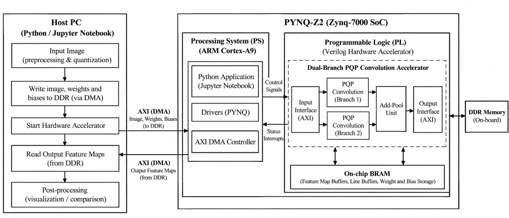

# RTL Design and FPGA Implementation

## 1. Introduction

The proposed dual-branch CNN hardware architecture was implemented using Verilog HDL and evaluated through Xilinx Vivado.

The RTL design was organised into individual functional modules to support modular development, simulation and integration.

The implementation covers input and weight storage, sliding-window generation, PQP convolution, SZW optimisation, Add-Pool processing and top-level integration.

## 2. RTL Module Organisation

The major hardware modules are organised according to their functionality.

| Module / Block | Implementation purpose |
|---|---|
| Image memory | Stores input image pixel values |
| Weight memory | Stores convolution kernel weights |
| Window generator | Extracts local pixel windows |
| PQP engine | Performs parallel pixel-weight computation |
| SZW modules | Implement zero-weight skipping |
| Add-Pool unit | Performs branch addition and max pooling |
| Dual-branch core | Integrates the convolution branches and processing units |
| Top-level module | Provides overall hardware integration |

The exact source filenames and module names are available in the `rtl/` directory.

## 3. Input and Weight Storage

Input image pixels and convolution weights are stored in memory arrays.

The memory modules provide the required data to the convolution engines.

Where applicable, memory initialisation files are loaded during simulation to supply test inputs and kernel values.

## 4. Sliding-Window Generator

The sliding-window generator calculates the pixel addresses required for convolution.

It uses image-position counters and address-generation logic to extract the required local pixel region.

For example, a 3 × 3 convolution operation requires nine neighbouring pixel values.

The extracted window is supplied to the corresponding convolution engine.

## 5. PQP RTL Implementation

The PQP engine implements parallel pixel-weight computation.

The main operations include:

- Receiving the input pixel window.
- Receiving the corresponding kernel weights.
- Performing parallel multiplication operations.
- Accumulating the partial products.
- Generating the convolution output.

The design uses arithmetic operators, registers and combinational/sequential logic according to the implementation requirements.

## 6. SZW RTL Implementation

The SZW logic checks whether the corresponding convolution weight is zero.

When the weight is non-zero, the associated multiplication and accumulation operation is performed.

When the weight is zero, the unnecessary MAC operation is skipped.

This logic reduces computations that do not contribute to the convolution output.

## 7. Add-Pool RTL Implementation

The fused Add-Pool unit performs two operations:

1. Element-wise addition of the two branch outputs.
2. 2 × 2 max pooling with stride two.

The addition logic combines corresponding feature-map values, while comparison and selection logic determines the maximum value in each pooling window.

The output is stored as the reduced feature map.

## 8. Top-Level Integration

The individual processing modules are connected through the dual-branch core.

The top-level design integrates the required processing, memory and interface logic.

The custom hardware is exposed through the top-level AXI IP interface for integration with the Zynq Processing System.

## 9. RTL Simulation and Verification

The design was evaluated using Verilog testbenches in Vivado simulation.

The verification process includes:

- Checking input pixel values.
- Checking kernel-weight values.
- Verifying convolution calculations.
- Observing intermediate processing results.
- Checking branch output dimensions.
- Verifying the Add-Pool output.
- Comparing the cycle count of the proposed and standard implementations.

Simulation waveforms are organised in the `results/simulation/` directory.

## 10. PS–PL Integration

The custom PQP hardware was packaged as an AXI-based IP core and integrated with the Zynq Processing System using Vivado IP Integrator.

The block design includes:

- Zynq7 Processing System (`processing_system7_0`).
- AXI SmartConnect (`axi_smc`).
- Processor System Reset (`rst_ps7_0_100M`).
- Custom PQP IP (`pqp_axi_top_0`).

The PS provides processor-side control and communication, while the PL contains the custom hardware processing architecture.

The AXI interface provides the communication path between the processor and the custom IP.

## 11. FPGA Implementation Flow

The hardware implementation follows these stages:

1. Verilog RTL development.
2. Functional simulation.
3. Custom IP packaging.
4. IP integration using Vivado Block Design.
5. Clock and reset configuration.
6. RTL synthesis.
7. FPGA implementation, including placement and routing.
8. Bitstream generation.

## 12. Target Hardware

| Parameter | Description |
|---|---|
| Development board | PYNQ-Z2 |
| SoC family | Zynq-7000 |
| Processing System | ARM Cortex-A9 |
| Programmable Logic | FPGA fabric |
| Design tool | Xilinx Vivado |
| Hardware description | Verilog HDL |

## 13. Reproducibility

To reproduce the design, use the Verilog source files, testbenches, required memory initialisation files and Vivado configuration files provided in this repository.

The exact Vivado version, device part number and any required IP dependencies should be specified in the main README or the relevant implementation instructions.
