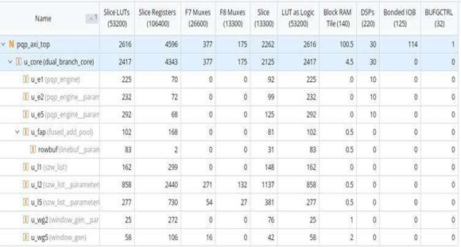
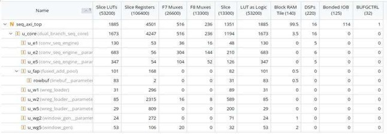
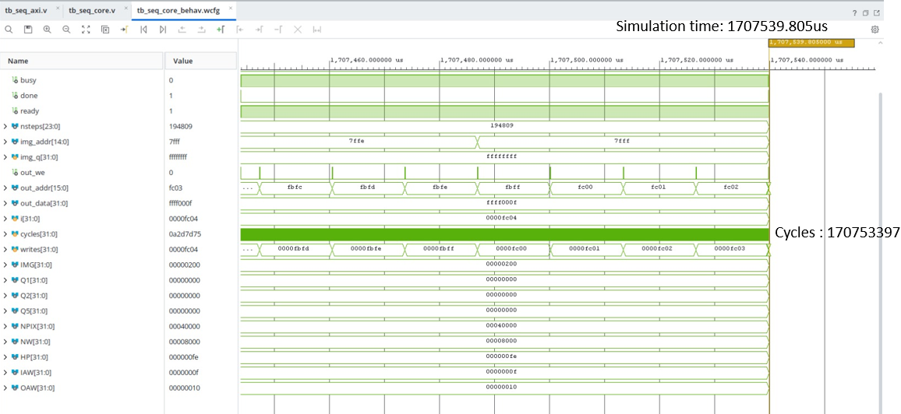
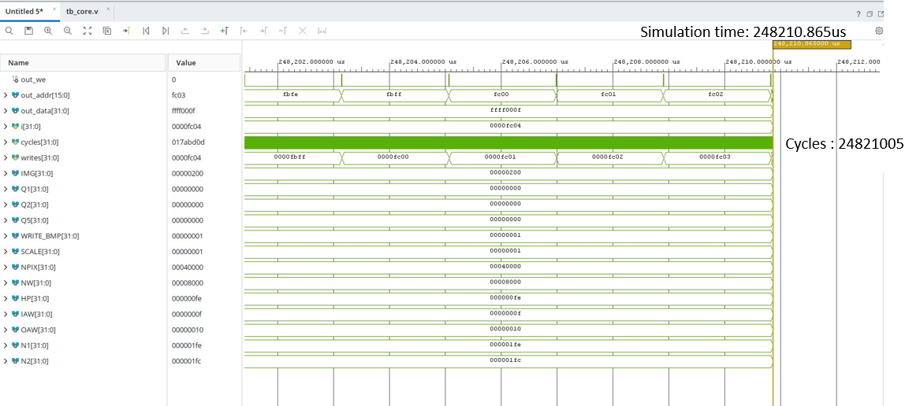

# Experimental Results

This directory contains the simulation outputs, generated feature maps and FPGA resource utilisation reports obtained during the evaluation of the proposed dual-branch CNN accelerator.

## 1. RTL Simulation Results

The simulation waveforms demonstrate the functional behaviour of the Dual branch PQP convolution.

 
This picture illustrates the signals involved in the convolution module during RTL simulation. The signals labelled Pixel Values represent the input pixel data, while the Weights signals represent the kernel coefficients used in the convolution operation. 
By comparing these outputs with the expected convolution calculations, the functional behavior of the module is verified for the tested inputs.

## 2. FPGA Resource Utilisation

Vivado synthesis reports were used to evaluate the FPGA resource requirements of the proposed PQP + SZW architecture and standard sequential convolution.

The utilization report for the pqp_axi_top design indicates that the LUT and register usage reflects the additional hardware required to support parallel arithmetic, data storage and control operations in the PQP architecture.

The utilization report for the seq_top design  indicates that the lower LUT and DSP usage is consistent with sequential processing, which reuses hardware resources across operations rather than performing multiple operations simultaneously. 
The PQP architecture requires additional parallel datapaths and associated control logic, increasing its hardware resource requirements in exchange for greater processing parallelism. 

| Resource | PQP + SZW | Standard Convolution |
|---|---:|---:|
| LUTs | 2,616 | 1,885 |
| Registers | 4,596 | 4,501 |
| DSPs | 30 | 16 |
| BRAM tiles | 100.5 | 99.5 |

## 3. Processing Performance

The RTL simulation waveforms of PQP convolution and Standard convolution attached depicts  the output address, output data, cycle count and write-control signals are visible during memory operations. 
The output address progresses and the data is updated, indicating successive output writes during the observed simulation interval.

| Parameter | PQP + SZW | Standard Convolution |
|---|---:|---:|
| Processing cycles | 24.8 million | 170.8 million |
| Estimated time at 100 MHz | 248 ms | 1,707 ms |

The proposed architecture achieves approximately 6.89× faster simulated processing, corresponding to an approximately 85.5% reduction in processing cycles.

## 4. Summary

The experimental results demonstrate the functional operation of the proposed hardware modules and the performance advantage of combining parallel convolution with zero-weight computation skipping.

The proposed architecture uses additional LUT and DSP resources to achieve a substantial reduction in processing cycles.
